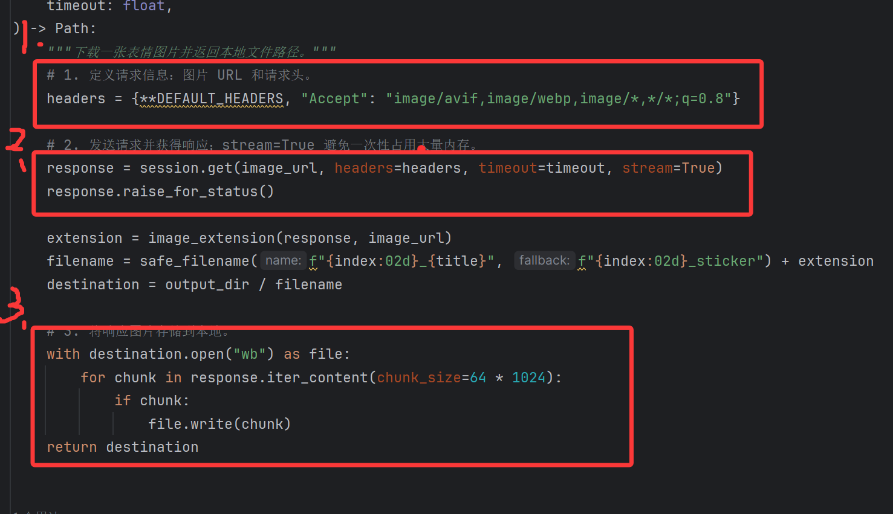
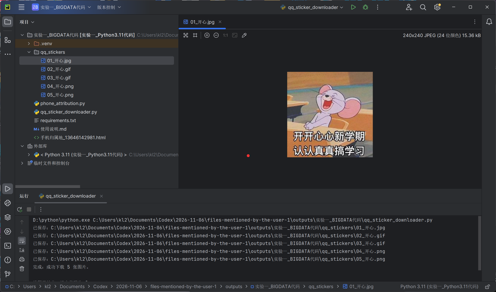
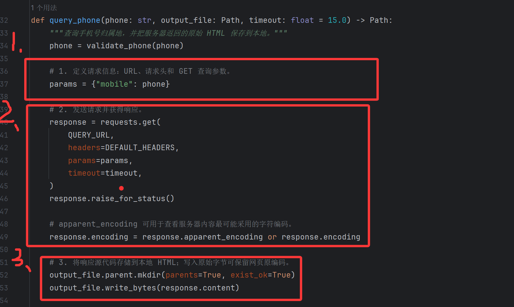
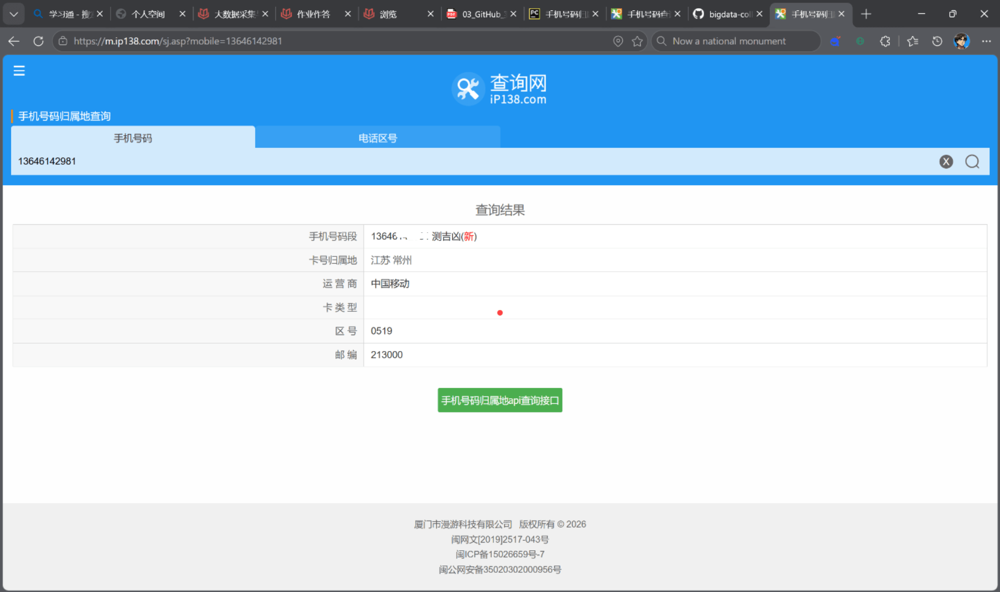

# 实验一 静态网页爬取

- 姓名：柳兆星
- 学号：112404150131
- 班级：数据科学与大数据技术软件1241班
- GitHub 用户名：KL2223
- 仓库地址：https://github.com/KL2223/bigdata-collection-labs-112404150131

## 一 实验目的与要求

### 1 实验目的

1. 理解网络爬虫的基本概念和请求响应流程。
2. 掌握 Requests 库发送 GET 请求、处理响应及异常的方法。
3. 掌握图片二进制数据和 HTML 文本数据的本地保存方法。

### 2 实验要求

1. 将 QQ 表情包下载功能重构为可复用函数。
2. 查询手机号码归属地，并将响应源代码保存为本地 HTML。
3. 对请求信息、发送请求和本地保存三个关键步骤进行截图标注。

## 二 实验平台与环境

- 开发语言：Python 3.11
- 调用的包：requests、pathlib、argparse、re
- 调试和运行环境：Windows 11、PyCharm

## 三 实验内容与完成情况

### 1 QQ 表情包图片下载代码

程序先定义请求地址、请求头和查询参数，再通过 `requests.get()` 发送请求，最后以二进制方式将响应图片写入本地文件。代码封装为函数，可通过关键词、下载数量和输出目录重复调用。



### 2 QQ 表情包本地保存结果

程序成功下载 5 张“开心”主题的 QQ 表情图片，并将图片保存到本地 `qq_stickers` 文件夹。



### 3 手机归属地查询代码

程序通过 GET 查询参数提交手机号码，获取响应后调用 `raise_for_status()` 检查 HTTP 状态，并将响应源代码保存为 HTML 文件。为避免在公开仓库中泄露个人信息，完整手机号不写入报告正文和代码常量。



### 4 手机归属地查询结果

本次查询结果显示号码归属地为江苏常州，运营商为中国移动。响应网页已保存到本地并可通过浏览器打开。



## 四 遇到的问题和解决方法

1. 直接运行手机号查询脚本时提示缺少 `phone` 参数。解决方法是在命令行或 PyCharm 运行配置中提供手机号参数。
2. 网络请求可能因超时或连接不稳定失败。解决方法是设置合理的 `timeout`，调用 `raise_for_status()`，并使用 `try/except` 捕获异常。
3. 部分接口未在响应头中准确声明字符编码。解决方法是根据接口实际编码设置 `response.encoding`，或使用 `response.apparent_encoding` 辅助判断。

## 五 未解决的问题

无。

## 六 重要知识点

### 1 使用 Requests 发送网络请求的代码是什么

```python
response = requests.get(url, headers=headers, params=params, timeout=15)
```

### 2 如何判断网站使用 GET 还是 POST 请求

在浏览器开发者工具的 Network 面板中完成一次查询操作，查看对应请求的 Method 字段；地址栏参数通常对应 GET 请求，请求体中的表单或 JSON 数据通常对应 POST 请求。

### 3 两个任务的请求信息还使用了哪些参数

- QQ 表情包下载使用了请求头 `headers` 和查询参数 `params`，其中包含关键词、页码和数量。
- 手机归属地查询使用了请求头 `headers` 和查询参数 `params`，其中包含待查询手机号。

### 4 如何处理中文乱码

```python
response.encoding = response.apparent_encoding
```

对于编码已知的接口，也可以直接设置为明确编码，例如 `response.encoding = "utf-8"`。

### 5 `response.content` 和 `response.text` 有什么区别

`response.content` 返回原始字节数据，适合保存图片、音频和原始文件；`response.text` 返回按照响应编码解码后的字符串，适合处理 HTML、JSON 以外的普通文本等内容。

### 6 `try/except` 机制有什么作用

`try/except` 用于捕获程序运行时可能出现的异常，使程序能够给出明确提示或继续执行，而不是直接崩溃。

### 7 `response.raise_for_status()` 有什么作用

当服务器返回 4xx 或 5xx HTTP 错误状态码时，`raise_for_status()` 会抛出异常，便于程序及时发现请求失败。

## 七 实验总结

本次实验完成了 JSON 接口和 HTML 网页两种数据源的请求与本地保存，掌握了 Requests 库的请求参数、响应处理、异常处理、编码处理以及二进制文件保存方法。
